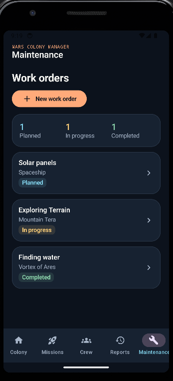
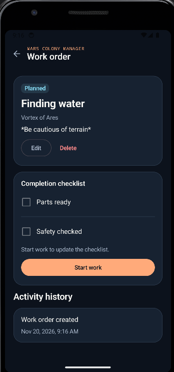
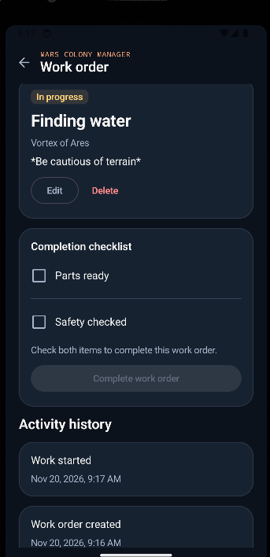
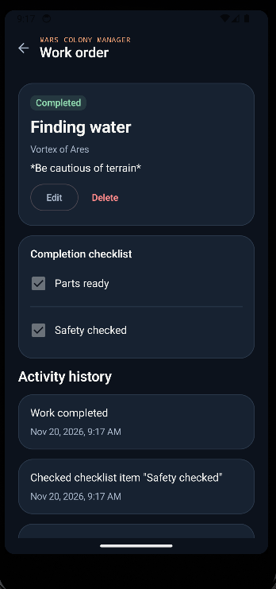
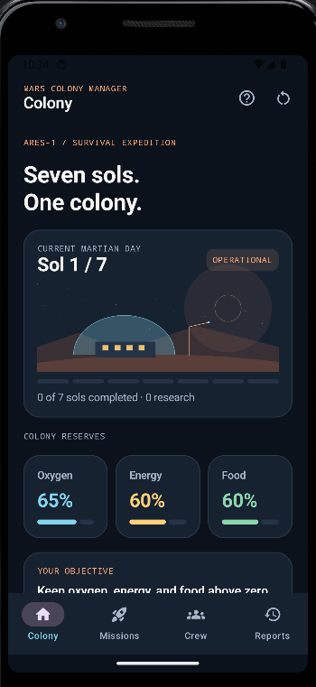
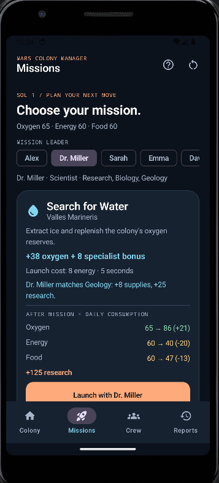
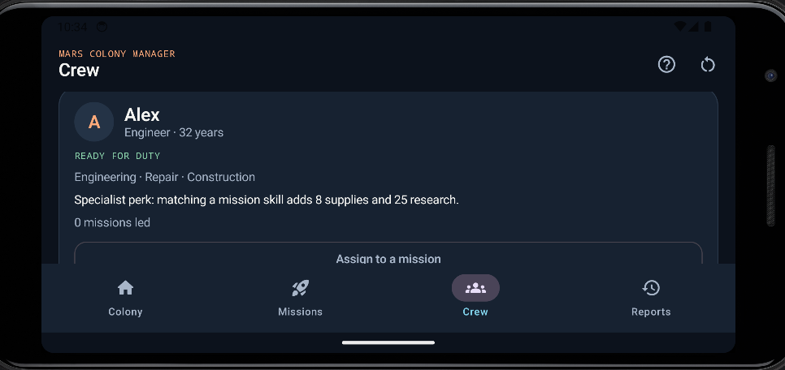

# Mars Colony Manager

I built Mars Colony Manager as a seven-sol survival game in Kotlin with Jetpack Compose. I extended the midterm version with Room storage and a Maintenance tab where I can create work orders, track progress, and review what happened.

## What I added

- I added a **Maintenance** tab with a work-order list, individual order details, and a shared create/edit form. The list uses a `LazyColumn` keyed by each order's Room ID. Navigation Compose uses that ID to open the corresponding order.
- I added a work-order workflow that moves from **Planned** to **In progress** and finally to **Completed**. To complete a job, I first start it and then check **Parts ready** and **Safety checked**. I can clear either check while the job is in progress.
- I added a timestamped history of creation, edits, checklist changes, and status changes. I can delete an order and its history after confirming the action.
- I added local storage for the expedition and maintenance records. When I reopen the app, I can see saved orders, activity history, reports, resources, and mission progress. An unfinished mission resumes from its saved progress.

## How I play the expedition

I start with 65 oxygen, 60 energy, and 60 food. Each resource has a storage cap of 100.

1. On **Missions**, I choose a leader in the crew selector. I can also assign a leader from **Crew**.
2. I compare the three mission forecasts, which already include costs and daily consumption.
3. I launch one mission. It takes five seconds with most crew members and three with Sarah.
4. When the mission ends, I check **Reports** for the leader, research reward, and before/after resources. The sol advances and that leader rests for the next mission.
5. I win by completing seven missions with all three resources above zero. If a resource reaches zero, the expedition ends.

Supplies stay constant while I plan. Only one mission can run at a time, and I can change screens or rotate the device while it runs. The restart button confirms before resetting the expedition and cancelling an active mission. Maintenance data is stored separately from the expedition.

### Mission effects

| Mission | Base supply reward | Energy cost | Specialist skill | Base research |
|---|---:|---:|---|---:|
| Search for Water | +38 oxygen | 8 | Geology | 100 |
| Solar Array Repair | +40 energy | 0 | Engineering | 120 |
| Greenhouse Expedition | +38 food | 6 | Biology | 150 |

Every completion consumes **14 oxygen, 12 energy, and 13 food**. The game deducts the launch cost, fills supplies up to 100, then applies daily consumption. A matching specialist grants eight additional units of the mission's main supply and 25 research.

| Crew member | Skills used in the game |
|---|---|
| Alex | Engineering for solar repairs |
| Dr. Miller | Geology and Biology for water or greenhouse missions |
| Sarah | Piloting for three-second missions and 25 extra research |
| Emma | Engineering for solar repairs |
| David | Geology for water missions |

My score is research plus twice the total remaining supplies, with 300 extra points for surviving all seven sols.

## How I use Maintenance

1. I open **Maintenance** and create an order with a title and location. I can add optional notes. The form trims whitespace and checks for a title of up to 80 characters, a location of up to 60, and notes of up to 500. It shows an error next to the field that needs fixing.
2. I open the order from the list to read its details or edit its title, location, and notes.
3. I start the order, mark **Parts ready** and **Safety checked**, and complete it once both boxes are checked. I can review how the order changed in its activity history.
4. I can delete the order from its detail screen. I can cancel the confirmation to keep the order and its history.

## How I structured the code

I kept the original activity, model, ViewModel, screen, component, and theme folders and added a `data/` package for Room and repositories.

| File or package | Role |
|---|---|
| `MainActivity.kt` | Hosts the app and connects the expedition and maintenance destinations with Navigation Compose |
| `ui/screens/` and `ui/components/` | Display state and send button clicks, form changes, and other events back through callbacks |
| `viewmodel/ColonyViewModel.kt` | Runs the mission timer and saves the expedition through the repository |
| `viewmodel/WorkOrderViewModel.kt` | Exposes the work-order list and details and handles status, checklist, and delete actions |
| `viewmodel/WorkOrderFormViewModel.kt` | Holds the create/edit form state, validates fields, and handles save |
| `model/` | Contains the game and work-order models and the expedition rules |
| `data/ColonyDatabase.kt` | Opens the local Room database, which stores work orders, activity entries, expedition progress, and mission reports |
| `data/WorkOrderRepository.kt`, `data/WorkOrderDao.kt` | Read and write orders and their history |
| `data/ColonyRepository.kt`, `data/ExpeditionDao.kt` | Read and write the expedition and its reports |

I collect ViewModel `StateFlow` in Compose with `collectAsStateWithLifecycle()`. Screen callbacks call ViewModel methods. The repositories use Room DAOs to read and write data. Room `Flow` then sends the latest stored orders to the ViewModels, so a change on the detail screen appears on the list automatically. For an order update with a history entry, I use a database transaction so both changes are saved together.

## Screenshots

### Maintenance



**Maintenance list.** I can see my work orders and how many are planned, in progress, or completed.



**Planned.** I review the Finding water order before I start it. The activity history shows when I created it.



**In progress.** I start the order. The Complete button stays disabled until I mark both checklist items.



**Completed.** I finish the checklist and complete the order. I can see the completion recorded in the activity history.

### Midterm







## How I push the update to GitHub

I use the same repository and push to the existing `main` branch. From the project root, I run these commands.

```powershell
git status --short --branch
git add app gradle build.gradle.kts README.md Mars-Colony-Assignment-Guide.pdf Screenshots
git status --short
git commit -m "Add persistent maintenance work orders"
git push origin main
```

I check the staged files before committing and confirm that the new commit appears on GitHub. If I push before taking the screenshots, I can add them in a follow-up commit.
