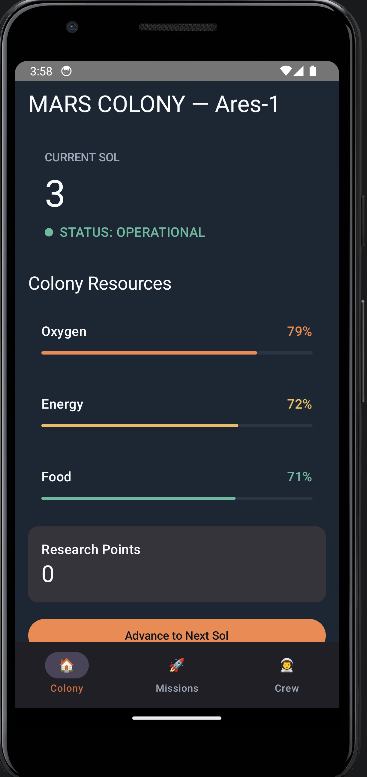
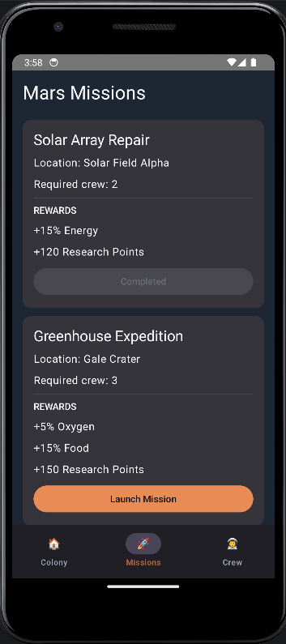
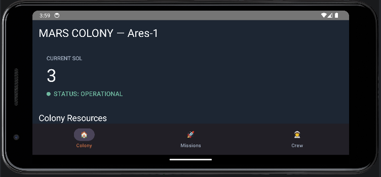

# Mars Colony Manager — Midterm

A seven-sol survival game built on the original Assignment 2 project using Kotlin, Jetpack Compose,
Material 3, ViewModel, and StateFlow. Lead Ares-1 through seven missions while protecting oxygen,
energy, and food. Pick a mission, assign a crew leader, inspect the forecast, and launch.

## What's new

- Four functional screens connected with **Navigation Compose**: Colony, Missions, Crew, and Reports.
- A clear seven-sol win condition and resource-depletion loss condition, with score and restart.
- Timed, non-blocking missions using **viewModelScope**, **delay**, and live progress.
- Crew skills affect rewards; Sarah's Pilot skill gives faster missions and extra research.
- The most recent mission leader rests for the next mission, encouraging crew rotation.
- Exact previews show resources after rewards, costs, storage caps, and daily consumption.
- A mission log records each leader, before/after resources, and research reward.
- Improved Mars colours, icons, resource cards, native habitat illustration, and in-app help.
- State survives rotation. SavedStateHandle also supports Android saved-instance restoration,
  including an unfinished mission. This is not a permanent disk-save system: removing the app's task
  or force-stopping it can start a fresh colony.

## How to play

Start with 65 oxygen, 60 energy, and 60 food. Each resource has a storage cap of 100.

1. On Missions, choose a leader using the horizontally scrolling crew selector, or assign one from Crew.
2. Compare the three mission forecasts. Costs and daily consumption are already included.
3. Launch one mission and wait for completion (5 seconds normally; 3 seconds with Sarah).
4. The mission rewards are applied, daily supplies are consumed, the report is recorded, and the next sol begins.
5. Repeat until seven missions are completed. All three resources must remain above zero, including on sol seven.

There is no resource drain while deciding. Only one mission can run at a time. You can navigate or rotate
while it runs. The most recent leader becomes available again after a different person completes a mission.
The restart icon asks for confirmation and cancels an active mission safely.

### Mission effects

| Mission | Normal reward | Energy launch cost | Specialist skill |
|---|---:|---:|---|
| Search for Water | +38 oxygen | 8 | Geology |
| Solar Array Repair | +40 energy | 0 | Engineering |
| Greenhouse Expedition | +38 food | 6 | Biology |

Every completion additionally consumes **14 oxygen, 12 energy, and 13 food**.
The mission energy cost is deducted, rewards fill storage up to 100, and then daily consumption applies.
A matching specialist adds **8 to the main supply reward** and **25 research**. Overflow is discarded;
the forecast shows the actual change after the storage cap.

| Crew member | Existing skills used in the game |
|---|---|
| Alex | Engineering: solar specialist |
| Dr. Miller | Geology and Biology: water and greenhouse specialist |
| Sarah | Piloting: 3-second missions and +25 research on any mission |
| Emma | Engineering: solar specialist |
| David | Geology: water specialist |

Everyone can lead every mission when available; specialists earn the stated bonus.
Base research rewards are 100 (water), 120 (solar), and 150 (greenhouse).
Score = research + 2 × remaining oxygen/energy/food + 300 for surviving all seven sols.

## Project structure

The original package, models, ViewModel, screens, component names, and theme folders are retained.
Only four Kotlin files were added; 

| Location | Responsibility |
|---|---|
| `MainActivity.kt` | Activity, Navigation Compose, four tabs, help/restart dialogs, shared crew selection |
| `model/ColonyState.kt` | Immutable colony resources, progress, outcome, and mission reports |
| `model/CrewMember.kt` | Original crew information plus skill-matching helpers |
| `model/Mission.kt` | Mission costs/rewards and the forecast data model |
| `model/ColonyRules.kt` (new) | Crew/mission data, forecasts, launch validation, completion rules |
| `model/MissionReport.kt` (new) | A completed sol's before/after record |
| `viewmodel/ColonyViewModel.kt` | StateFlow, coroutine mission lifecycle, reset, SavedStateHandle |
| `ui/components/` | Existing cards plus shared `ColonyComponents.kt` (new) |
| `ui/screens/` | Original three screens plus `ReportsScreen.kt` (new) |
| `ui/theme/` | Mars colours and consistent typography |

The UI collects state with `collectAsStateWithLifecycle()`. Small UI selections and search use
`rememberSaveable`; temporary dialogs and derived forecasts use `remember`. Crew selection is hoisted
above the screens, and card buttons emit actions to the ViewModel. Forecast and completion use the same rules.

## Screenshots

Are located in the Screenshots folder.

